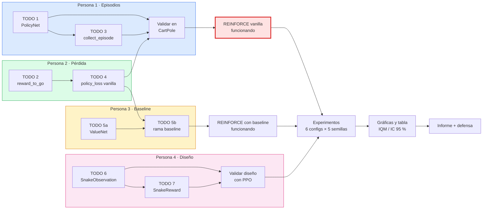

# Estado del proyecto · REINFORCE en el Snake (Lab 3.3)

> Documento de seguimiento del equipo. Se actualiza en cada hito.
> Última actualización: 2026-11-04 · Estado global: **análisis y reparto hechos, implementación sin empezar**

## Equipo

Escribe tu nombre en la fila que te toque. El reparto es una propuesta: se puede intercambiar entre personas.

| Rol | Nombre |
|---|---|
| Persona 1 | _[escribe aquí tu nombre]_ |
| Persona 2 | _[escribe aquí tu nombre]_ |
| Persona 3 | _[escribe aquí tu nombre]_ |
| Persona 4 | _[escribe aquí tu nombre]_ |

---

## 1. Qué hay que entregar

Implementación evaluable de la Unidad 3 (**15 % de la nota**, con evaluación individual):

1. **Código:** REINFORCE desde cero en PyTorch, aplicado al Snake con observación y recompensa propias.
2. **Resultados:** 5 semillas por configuración, medidos en **manzanas por partida** (no en retorno, porque con recompensas distintas los retornos no son comparables).
3. **Informe:** máximo 4 páginas.

Reglas: se permite PyTorch y Gymnasium. **No** se permite usar una implementación ya hecha del algoritmo.

---

## 2. Dónde estamos

### Punto de partida
El profesor entrega una carpeta (`experiments_3`) con los laboratorios de la Unidad 3. Para nuestra entrega solo importa el **Lab 3.3**: un esqueleto de REINFORCE y un entorno de Snake ya listos, donde faltan las partes que tenemos que escribir nosotros.

### Qué ya viene hecho (no hay que programarlo)
- El **entorno del Snake** (`snake_env.py`), con su observación y recompensa originales.
- El **bucle de entrenamiento**, la evaluación periódica, TensorBoard y el guardado de resultados.
- Las **referencias de SB3** (A2C y PPO) para comparar contra nuestro REINFORCE.
- Las **gráficas** (`plot_results.py`) con curvas medias, intervalo de confianza e IQM.
- Las **autocomprobaciones** (`--check`) que validan cada hueco antes de entrenar.

### Qué falta (esto es lo que tenemos que hacer)
Hay **7 huecos marcados como `TODO`**, que ahora mismo lanzan `NotImplementedError`:

| TODO | Archivo | Qué falta escribir |
|---|---|---|
| 1 | `lab_3_3_reinforce.py` | La red de política (`PolicyNet`): MLP de 2 capas con tanh que devuelve logits |
| 2 | `lab_3_3_reinforce.py` | `reward_to_go`: los retornos descontados de cada paso |
| 3 | `lab_3_3_reinforce.py` | `collect_episode`: jugar una partida y guardar observaciones, acciones, log-probabilidades y recompensas |
| 4 | `lab_3_3_reinforce.py` | `policy_loss` en su versión vanilla: la pérdida de REINFORCE |
| 5 | `lab_3_3_reinforce.py` | `ValueNet` y la versión con baseline de `policy_loss` |
| 6 | `snake_design.py` | `SnakeObservation`: la observación que ve el agente |
| 7 | `snake_design.py` | `SnakeReward`: la recompensa propia (opcional, pero se valora) |

Además, hay que **lanzar los experimentos, analizar los resultados, escribir el informe y preparar la defensa**.

### Qué hemos hecho hasta ahora
- Analizar el proyecto completo y entender qué archivos se usan y cuáles no.
- Diseñar el reparto en 4 personas.
- Preparar el `requirements.txt` reducido, el README del repo y este documento.


### Siguiente paso inmediato
1. Cada persona escribe su nombre en la tabla del equipo y confirma su parte.
2. Cada uno empieza por su primer TODO (ver sección 5).

> El proyecto original no se ha modificado. Siempre se trabaja sobre la copia del repositorio.

---

## 3. Checklist

Marca con `x` lo que vaya terminando.

**Preparación**
- [ ] Nombres de las 4 personas escritos arriba
- [ ] Repositorio creado y ramas por persona
- [ ] Copia del proyecto original conservada
- [ ] Archivos no usados movidos a la carpeta de respaldo
- [ ] `requirements.txt` reducido y probado en un entorno limpio
- [ ] README adaptado y `.gitignore` creado
- [ ] Baselines SB3 con la observación original lanzados

**Persona 1**
- [ ] TODO 1 · `PolicyNet`
- [ ] TODO 3 · `collect_episode`
- [ ] Validado en CartPole
- [ ] Configs `reinforce_original_sparse` y `ppo_custom_sparse`
- [ ] Ablación de `--lr`
- [ ] Sección del informe

**Persona 2**
- [ ] TODO 2 · `reward_to_go`
- [ ] TODO 4 · `policy_loss` vanilla
- [ ] Configs `reinforce_custom_sparse` y `a2c_custom_sparse`
- [ ] Ablación de normalización (`--no-normalize`)
- [ ] Gráficas y tabla de resultados
- [ ] Sección del informe

**Persona 3**
- [ ] TODO 5 · `ValueNet` y baseline
- [ ] Sin fugas de gradiente (`--check`)
- [ ] Config `reinforce_baseline_custom_sparse`
- [ ] Ablación G / A / nada
- [ ] Plantilla e integración del informe
- [ ] Sección del informe

**Persona 4**
- [ ] TODO 6 · `SnakeObservation`
- [ ] TODO 7 · `SnakeReward`
- [ ] Diseño validado con PPO
- [ ] Config `reinforce_baseline_custom_custom`
- [ ] Ablación de recompensa (`distance` frente a `custom`)
- [ ] Guion de la defensa
- [ ] Sección del informe

**Cierre**
- [ ] Matriz completa de experimentos terminada (6 configuraciones × 5 semillas)
- [ ] Gráfica final y tabla de resultados
- [ ] Revisión cruzada del informe
- [ ] Informe ≤ 4 páginas
- [ ] Ensayo cruzado de la defensa

---

## 4. Archivos del proyecto

**Se usan:**

| Archivo | Función |
|---|---|
| `lab_3_3_reinforce.py` | REINFORCE: es parte de la entrega (TODO 1–5) |
| `snake_design.py` | Observación y recompensa: es parte de la entrega (TODO 6–7) |
| `snake_env.py` | Entorno `DeustoSnake-v0` |
| `common3.py` | Semillas, rutas y guardado de resultados (lo importan los demás) |
| `lab_3_3_referencia_sb3.py` | A2C y PPO de SB3 como referencia |
| `plot_results.py` | Curvas, IC 95 % por bootstrap e IQM |
| `requirements.txt` | Dependencias (reducidas al Lab 3.3) |
| `README.md` | Documentación del repo |

**No se usan (se mueven a una carpeta de respaldo, no se borran):** `lab_3_1_dqn.py`, `lab_3_2_ablacion.py`, `lab_3_4_ppo_a2c.py`, `lab_3_5_continuo.py`, `shower_continuous.py`, `lab_3_6_her.py`, `lab_3_7_optuna.py`. Ninguno de los archivos que se usan depende de estos.

`colab_unidad3.ipynb` solo se conserva si se entrena en Colab.

---

## 5. Cómo se divide el trabajo

El criterio es que **cada persona tenga el mismo tipo de aportación** y todas sean evaluables por separado: un bloque de código, experimentos propios, una pregunta de análisis, una sección del informe y una tarea de apoyo.

### 5.1 Código

| Persona | TODOs | Archivo | Carga aprox. |
|---|---|---|---|
| **Persona 1** | 1 `PolicyNet` + 3 `collect_episode` | `lab_3_3_reinforce.py` | ~23 líneas |
| **Persona 2** | 2 `reward_to_go` + 4 `policy_loss` (vanilla) | `lab_3_3_reinforce.py` | ~16 líneas |
| **Persona 3** | 5 `ValueNet` + baseline | `lab_3_3_reinforce.py` | ~25 líneas |
| **Persona 4** | 6 `SnakeObservation` + 7 `SnakeReward` | `snake_design.py` | ~45 líneas |

La Persona 4 tiene más código pero es la parte más abierta y creativa. Las Personas 1 y 2 lo compensan con más experimentos de referencia y análisis.

### 5.2 Experimentos

Seis configuraciones, 5 semillas (0–4) y 200 000 pasos cada una, más una ablación por persona.

| Persona | Configuraciones | Ablación propia |
|---|---|---|
| **Persona 1** | `reinforce_original_sparse`, `ppo_custom_sparse` | Variar `--lr` |
| **Persona 2** | `reinforce_custom_sparse`, `a2c_custom_sparse` | `--no-normalize` frente a normalizar G |
| **Persona 3** | `reinforce_baseline_custom_sparse` | Normalizar G, A o nada |
| **Persona 4** | `reinforce_baseline_custom_custom` | Recompensa `distance` frente a `custom` |

### 5.3 Pregunta de análisis (cada uno defiende la suya)

| Persona | Pregunta |
|---|---|
| **Persona 1** | `terminated` frente a `truncated`: ¿afecta a REINFORCE y al baseline? |
| **Persona 2** | ¿Por qué reward-to-go y no el retorno total? ¿Qué hace normalizar G? |
| **Persona 3** | ¿Cuánto reduce la varianza el baseline? ¿Por qué hace falta `detach()`? |
| **Persona 4** | ¿Qué observación necesita el agente? ¿Aparece el efecto cobra con la recompensa propia? |

### 5.4 Apoyo (para que nadie cargue con toda la infraestructura)

| Persona | Tarea |
|---|---|
| **Persona 1** | Repositorio git, ramas, entorno y Colab |
| **Persona 2** | Gráficas y tabla IQM/IC 95 % con `plot_results.py` |
| **Persona 3** | Plantilla del informe e integración final |
| **Persona 4** | Guion de la defensa y del cambio en directo |

### 5.5 Informe

Cada persona escribe **su sección** (~0,8 páginas) y se revisa en cruz.

| Sección | Autor |
|---|---|
| Algoritmo y entorno | Persona 1 |
| Pérdida y normalización | Persona 2 |
| Baseline | Persona 3 |
| Diseño del Snake | Persona 4 |
| Introducción y conclusiones | Todos (un párrafo cada uno) |

Revisión cruzada: Persona 1 → 2 → 3 → 4 → 1. La revisión valida el contenido, pero la autoría de cada sección queda clara. Total máximo: 4 páginas.

---

## 6. Dependencias y orden

### 6.1 Diagrama por persona

Cada color es una persona. Las flechas indican «necesita que esté hecho antes». Si el diagrama no se ve en tu editor, usa la versión de texto de más abajo.



### 6.2 Versión de texto

```
 PERSONA 4 (independiente)
   TODO 6 observación ──► TODO 7 recompensa ──► validar con PPO ───────────────┐
                                                                               │
 PERSONA 1                    PERSONA 2                                        │
   TODO 1 PolicyNet ──┐         TODO 2 reward_to_go ──┐                         │
   TODO 3 collect_ep ─┴──┐                            └─► TODO 4 policy_loss   │
                         │                                    │                │
                         └──► validar en CartPole ◄───────────┘                │
                                      │                                        │
                                      ▼                                        │
                          ★ REINFORCE vanilla funcionando ★                    │
                                      │                                        │
 PERSONA 3                            │                                        │
   TODO 5a ValueNet ──► TODO 5b baseline (necesita TODO 4) ──► con baseline    │
                                      │                              │         │
                                      └──────────────┬───────────────┘         │
                                                     ▼                         │
                                  EXPERIMENTOS (6 configs × 5 semillas) ◄──────┘
                                                     │
                                                     ▼
                                       Gráficas y tabla ──► Informe + defensa
```

### 6.3 Quién espera a quién

| Persona | ¿Puede empezar ya? | ¿Qué le bloquea? | ¿A quién desbloquea? |
|---|---|---|---|
| **Persona 1** | Sí (`PolicyNet`) | `collect_episode` necesita `PolicyNet`, que es suyo | A las Personas 2 y 3, que necesitan `collect_episode` para el `--check` |
| **Persona 2** | Sí (`reward_to_go`) | Para probar `policy_loss` con `--check` necesita `collect_episode`; mientras tanto usa episodios simulados a mano | A la Persona 3 (rama baseline) |
| **Persona 3** | Sí (`ValueNet`) | La rama baseline necesita `policy_loss` vanilla de la Persona 2 | A los experimentos con baseline |
| **Persona 4** | Sí, sin esperar a nadie | Nada | A los experimentos: sin diseño `custom` no hay configuraciones `custom` |

> **Cuello de botella:** el ★ vanilla funcionando ★ (Personas 1 y 2). Es el hito que desbloquea los experimentos, así que conviene terminarlo pronto.

---

## 7. Plan por fases

| Fase | Qué se hace | Hito de salida |
|---|---|---|
| **0 · Preparación** | Repo, ramas, entorno, README y `.gitignore`. Baselines SB3 con la observación original. | Todos pueden ejecutar `python snake_env.py` |
| **1 · Implementación** | Cada uno sus TODOs. `--check` en cada paso. La Persona 1 valida en CartPole. La Persona 4 valida el diseño con PPO. | `--check` sin errores |
| **2 · Integración** | Merge de las Personas 1, 2 y 3. Prueba de una semilla con la observación original. | REINFORCE vanilla aprende (supera al azar) |
| **3 · Experimentos** | Se lanza la matriz completa (sección 5.2) y las ablaciones. | 30 ejecuciones terminadas |
| **4 · Análisis e informe** | Gráficas, tabla, borradores por sección y revisión cruzada. | Informe de ≤ 4 páginas |
| **5 · Defensa** | Ensayo cruzado del «cambio en directo». | Todos explican todo el código |

Fechas límite: **_[rellenar con las del curso]_**.

---

## 8. Reglas de trabajo en equipo

- **Un archivo, un dueño.** `snake_design.py` es de la Persona 4. `lab_3_3_reinforce.py` lo comparten las Personas 1, 2 y 3, cada una en sus funciones.
- **`policy_loss` es compartida entre las Personas 2 y 3.** La Persona 2 escribe la rama vanilla. La Persona 3 añade la rama con `value_net` **después** del merge de la Persona 2, y entretanto trabaja solo en `ValueNet`.
- **Las firmas y los diccionarios de `collect_episode` no se cambian.** Están fijados en los docstrings del código.
- **Git:** una rama por persona, pull requests pequeños, mensajes claros. No se sube `logs/`; la gráfica final sí.
- **Semillas 0–4 para todos**, para que las comparaciones sean justas.
- **Cada uno firma su trabajo:** los commits van a nombre de quien los hace.
